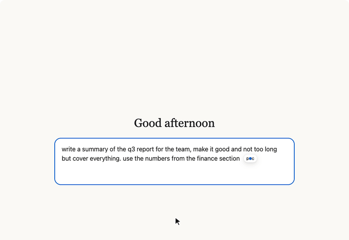

# P.O.C — Prompt Optimization Coach

A small coach that lives in every text box in Chrome. Write a draft, hover the dot beside your cursor, answer a few quick questions about what you meant, and get a sharper version written back into the box.



- **Works everywhere you write.** ChatGPT, Claude, Gemini, Gmail, Slack in the browser, GitHub comments, any multi-line text box.
- **Knows who is reading.** A prompt for an AI gets prompt coaching. An email to a person gets a clearer message, not an AI prompt.
- **Asks before it rewrites.** It asks about what only you know, such as who it's for and what matters most. It doesn't guess.
- **Never interrupts.** Nothing is sent anywhere until you click **Coach this draft**.
- **Free if you want it to be.** Run it on your own computer with Ollama, or bring a key from Anthropic, OpenAI or Google.

> **Beta.** It works, and it will have rough edges. [Open an issue](https://github.com/brycekallio/poc/issues) if something breaks.

## Install

P.O.C isn't on the Chrome Web Store yet, so you add it by hand. It takes about a minute.

1. Download **[poc-extension.zip](https://github.com/brycekallio/poc/releases/latest/download/poc-extension.zip)** and unzip it. Keep the folder somewhere permanent, because Chrome loads it from there each time.
2. In Chrome, go to `chrome://extensions`.
3. Turn on **Developer mode** (top right).
4. Click **Load unpacked** and choose the unzipped folder. It's the one with `manifest.json` directly inside it.
5. A setup page opens. Follow it.

Also works in Edge, Brave and Arc, which all run Chrome extensions. Click the puzzle-piece icon in the toolbar and pin **P.O.C** to keep the switch handy.

## Choose your AI

The setup page walks you through this. You can change it any time in **Settings**.

| | Cost | Privacy | Quality |
|---|---|---|---|
| **Ollama** (default) | Free | Your text stays on your computer | Good for everyday drafts; can be slower |
| **Google Gemini** | Free tier for light use | Sent to Google | Strong |
| **Anthropic** | About $0.20–$8 per 100 uses, depending on model | Sent to Anthropic | Strong |
| **OpenAI** | Pay per use | Sent to OpenAI | Strong |
| **Other** | Depends | Depends | LM Studio, OpenRouter, Groq, or anything OpenAI-compatible |

### Free: run it on your computer with Ollama

[Ollama](https://ollama.com) is a free app that runs AI models on your own machine. No account, no key, no cost.

1. Download Ollama from **[ollama.com/download](https://ollama.com/download)**, install it and open it.
2. Go back to the P.O.C setup page. It finds Ollama by itself.
3. If you have no models yet, click **Download qwen2.5** (4.7 GB, a few minutes). You want about 8 GB of memory free.
4. Click **Use this**.

Already have models? They appear in the list. Larger models give better questions and take longer. The first request after a restart is the slowest, because the model has to load.

### With an API key

An API key is a password that lets P.O.C use a provider's AI on your account. You pay the provider directly, per use. There's no P.O.C account or subscription.

| Provider | Where to get a key | Good to know |
|---|---|---|
| Anthropic | [console.anthropic.com/settings/keys](https://console.anthropic.com/settings/keys) | Add a small credit balance first. Sonnet costs about $4 per 100 uses at list price. |
| OpenAI | [platform.openai.com/api-keys](https://platform.openai.com/api-keys) | Add a small credit balance first. A ChatGPT subscription doesn't include API use. |
| Google Gemini | [aistudio.google.com/apikey](https://aistudio.google.com/apikey) | Has a free tier, with rate limits. |

1. Create a key on the provider's site and copy it.
2. On the P.O.C setup page, click the provider and paste the key.
3. Click **Connect**. P.O.C makes one tiny request to check it, then picks a model. You can choose a different one in **Settings**.

### Other servers

In **Settings**, choose **Other**, then enter the server's address and a key if it needs one. For LM Studio, start its local server and use `http://localhost:1234/v1`.

## Using it

1. Click into any multi-line text box and start typing. A small **p●c** dot appears beside your cursor.
2. Hover the dot and click **Coach this draft**, or press **⌘⇧P** (**Ctrl+Shift+P** on Windows).
3. Answer the questions, or skip them.
4. Check the rewrite and click **Use this**.

**To turn it off,** click the P.O.C icon in your toolbar and flip the switch. The dot disappears everywhere straight away, and the icon shows **OFF**.

## Privacy

There's no P.O.C server, account or analytics.

- **Your text** is read only inside your browser. It's sent to the AI you chose only when you click **Coach this draft**. With Ollama, it never leaves your computer.
- **Your keys** are stored only in this browser, are never synced, and are sent only to that key's provider.

Chrome will warn that P.O.C can "read and change all your data on all websites". It needs that to show the dot in any text box. The code is here for anyone to check, and [PRIVACY.md](store/PRIVACY.md) has the details.

## Troubleshooting

| What you see | What to do |
|---|---|
| No dot | Check that the toolbar switch is **On**. The dot appears only in multi-line boxes with text in them, not search bars or logins. |
| "Ollama is not running" | Open the Ollama app. Its icon should be in your menu bar or system tray. |
| "The response came back malformed" | Try again, or pick a larger model in **Settings**. Small models sometimes return broken answers. |
| Rate limit message | You've hit the provider's limit, which is common on free tiers. Wait a minute. |
| A site's box doesn't work | Google Docs and other canvas-based editors aren't normal text boxes, so P.O.C can't read them. |
| P.O.C says it was updated | Reload the page. |

P.O.C runs in Chrome only, so it can't reach desktop apps.

## Build from source

Requires Node 20 or newer.

```sh
git clone https://github.com/brycekallio/poc.git
cd poc/extension
npm install
npm run build     # builds to extension/dist; load that folder unpacked
npm test          # no network or keys needed
npm run package   # builds poc-extension.zip
```

`npm run try -- --provider ollama "your draft"` runs the question step from a terminal, which is handy for tuning the prompts in `src/coach.js`.

## How it's organized

| | |
|---|---|
| `extension/src/content.js` | Runs in the page: finds the box, draws the dot, never sees a key |
| `extension/src/session.js` | One coaching session: ask, answer, rewrite, use. Pure logic |
| `extension/src/coach.js` | The two AI steps and the checks on each rewrite |
| `extension/src/llm.js` | Talks to every provider |
| `extension/src/worker.js` | The background script, and the only place a coaching request reads a key |
| `store/` | Chrome Web Store listing, privacy policy and screenshots |
| `site/` | Marketing page |

## License

[MIT](LICENSE). Geist font under the SIL Open Font License.
